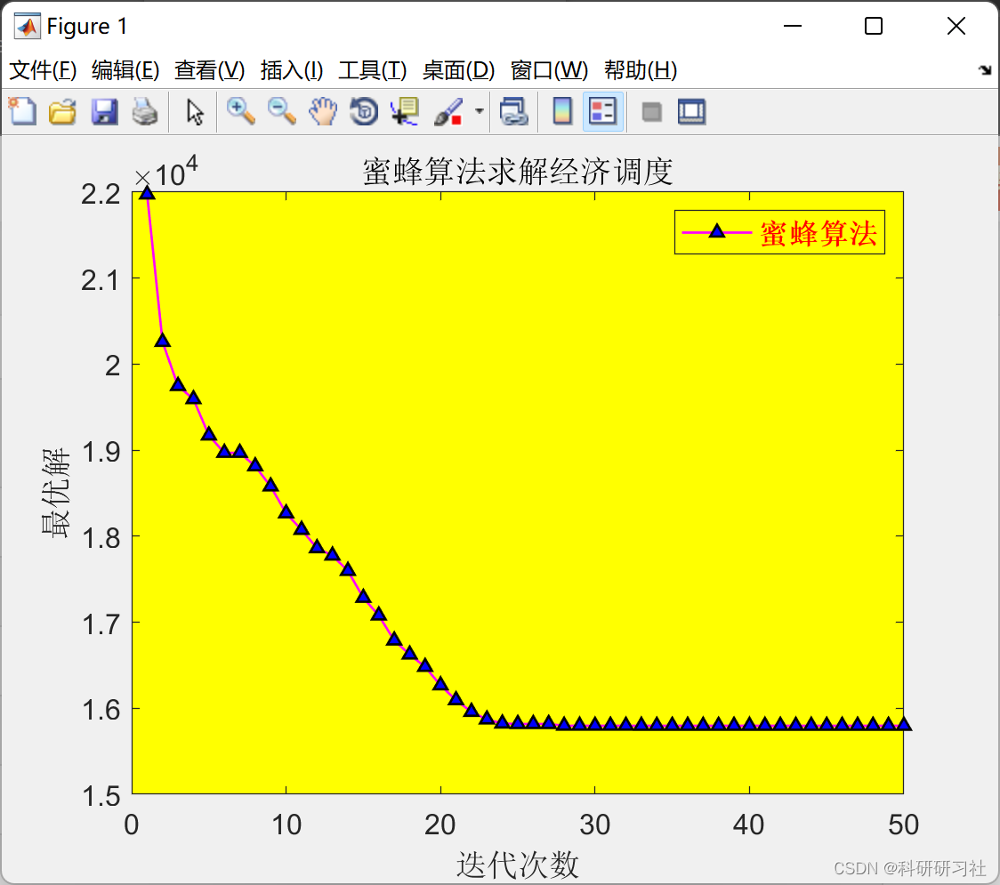

# Economic Dispatch of Power System Based on Bee Colony Algorithm (Matlab Code Implementation)

1. Bee Optimization Algorithm (BA)
The Bees Algorithm, proposed by Afshin Ghanbarzadeh and his research team in 2005, is a novel population-based optimization algorithm distinct from the Ant Colony Optimization (ACO) and Particle Swarm Optimization (PSO) algorithms. It searches for the optimal solution of mathematical problems through simulating the foraging behavior of bee colonies.
In foreign countries, the Bees Algorithm has been widely applied to continuous optimization problems such as data clustering analysis, electronic design, function optimization, mechanical design, robot control, neural network training, and also to combinatorial optimization problems including container loading, feature extraction, job scheduling, TSP, etc. Extensive research results have shown that the Bees Algorithm, when combined with neighborhood search and random search, can effectively solve various large-scale combinatorial optimization problems and function optimization problems. However, there is currently no dedicated theoretical research and application study on the Bees Algorithm domestically. Only some scholars have used the principle of the bee colony foraging mechanism to improve genetic algorithms, known as the Bees Genetic Algorithm (BGA) or the Bee Evolutionary Genetic Algorithm (BEGA). These algorithms add steps that simulate the foraging mechanism of bees during the process of gene evolution, which enhances both the global search capability and convergence speed of genetic algorithms, achieving good application effects.
1.1 The foraging mechanism of the bee colony
The bee colony can simultaneously find a large number of nectar or pollen sources in different directions across a wide geographical area. Bees are attracted to food sources with better quality, more quantity, and closer distance, while those with poorer quality, less quantity, and farther distance only attract a small number of bees. Firstly, the colony sends out a group of scout bees to different locations and randomly searches for nectar or pollen nearby. Once a food source is found, the scout bee returns to the hive and dances "round" or "8-letter dance" to inform other worker bees about the food source. The information about the food source mainly includes three aspects: direction, distance, and quality of the food. Based on this information, the colony evaluates different food sources and then sends out a large number of collector bees to better food sources and a small number of collector bees to poorer food sources. This foraging mechanism enables the colony to collect food quickly and effectively.
1.2 Bee Algorithm
The core idea of the Bee Algorithm (BA) is to simulate the above foraging mechanism through computer simulation. When using the Bee Algorithm for optimization calculations, several parameters need to be set: the number of scout bees (n), the number of good search areas selected from n collection points (m, m < n), the number of best search areas selected from m search areas (e, e < m), the number of collected bees recruited by each of the e best search areas (nep), and the number of collected bees recruited by each of the m - e search areas (nsp, nsp < nep), as well as the size of the search neighborhood (ngh), and the criteria for terminating iterations.
1.3 The calculation process of the Bee Algorithm is as follows:
Step 1. Randomly initialize the positions of n scout bees and calculate their fitness values; Step 2. Select m scout bees with better fitness values for neighborhood (NGH) search and calculate their fitness values; Step 3. Select e scout bees with the best fitness values and recruit nep honeybees for neighborhood search, calculating the fitness values of each honeybee; Step 4. Select m - e scout bees with second-best fitness values and recruit nsp honeybees for neighborhood search, calculating the fitness values of each honeybee; Step 5. For each food source, select the honeybee with the highest fitness value from all the bees on that food source; Step 6. Remaining n - m scout bees randomly search within the problem's solution space and calculate their fitness values; Step 7. Return to Step 2 until the termination condition is met. In Steps 3 and 4, when recruiting honeybees to the best and second-best food sources for neighborhood searches, the number of honeybees assigned to each food source varies. The selection probability can be based on the fitness values of the scout bees. In Step 5, only the honeybee with the highest fitness value in each food source is retained to form the next generation of bee populations. This is not a limitation in real bee colonies; this step is merely to reduce the number of search points. In Step 6, the remaining n - m scout bees will be randomly distributed within the search space to find new feasible solutions. After each iteration, a new bee population will consist of two parts: one part consists of the m honeybees that have been found in the selected food source neighborhood, and the other part consists of the n - m scout bees responsible for random searches.
Economic dispatch in power systems (Matlab complete code implementation)
Improving Particle Swarm Optimization for Solving Economic Dispatch Problems in Power Systems (Matlab implementation)
Multiverse algorithm for solving multi-objective optimization problems in power systems (Matlab implementation) [Electrical journal paper replication and case innovation]  
Wind power stochastic dynamic economic dispatch model (Python & Matlab codes)  
Particle swarm algorithm for solving environmental and economic dispatch of power systems + microgrid dispatch (wind, solar, electric vehicles, diesel engines, main grid) (Python code implementation)  
Economic dispatch of power systems (Matlab code implementation) [Yalmip + Gurobi]  
MATLB|Economic dispatch with energy storage and opportunity constraints and robust optimization  
Microgrid day-ahead economic dispatch based on wind and solar energy storage and demand response (Python code implementation) [1]  
Multi-objective Grey Wolf Algorithm for solving environmental and economic dispatch problems (IEEE30) (Matlab implementation)  
Multi-objective Genetic Algorithm NSGAII for solving environmental and economic dispatch (Python code implementation)  
Improved Multi-objective Differential Evolution Algorithm Application in Power System Environmental and Economic Dispatch (Python code implementation) [Electrical journal paper replication]  
4 Results ​Edit  
5 Matlab Code and Article This article only showcases part of the code, all codes can be found in:
for i = nEliteSite+1:nSelectedSite\nbestnewbee.Cost = inf;\nfor j = 1:nSelectedSiteBee\nnewbee.Position = BeeDance(bee(i).Position, r);\n[newbee.Cost newbee.Sol] = CostFunction(newbee.Position);\nif newbee.Cost<bestnewbee.Cost\nbestnewbee = newbee;\nend\nend\nif bestnewbee.Cost<bee(i).Cost\nbee(i) = bestnewbee;\nend\nend\n% Non-Selected Sites\nfor i = nSelectedSite+1:nScoutBee\nbee(i).Position = unifrnd(VarMin, VarMax, VarSize);\n[bee(i).Cost bee(i).Sol] = CostFunction(bee(i).Position);\nend\n% Sort\n[~, SortOrder] = sort([bee.Cost]);\nbee = bee(SortOrder);\n% Update Best Solution Ever Found\nBestSol = bee(1);\n% Store Best Cost Ever Found\nBestCost(it) = BestSol.Cost;\n% Display Iteration Information\ndisp(['In Iteration No ' num2str(it) ': Bees Cost is = ' num2str(BestCost(it))]);\n% Damp Neighborhood Radius\nr = r*rdamp;\nend\n  
5. References [1] Yu Min. The Bee Algorithm and Its Application in the Optimization of Hydropower Station Scheduling [J]. Guangdong Water Conservancy and Hydropower, 2015(04):15-18.
6. End Note

## Images

<!-- PAYMENT_BLOCK -->

## Get this dataset

- Payment link (Stripe): [Buy now](https://buy.stripe.com/3cs8yP7sY87d0vu9AB)
- Payment QR code: 

<!-- /PAYMENT_BLOCK -->
